## Terraform Configuration Screenshots

The following screenshots show the Terraform files I used to create my AWS infrastructure and explain what I configured in each section.

### 1. AWS Provider

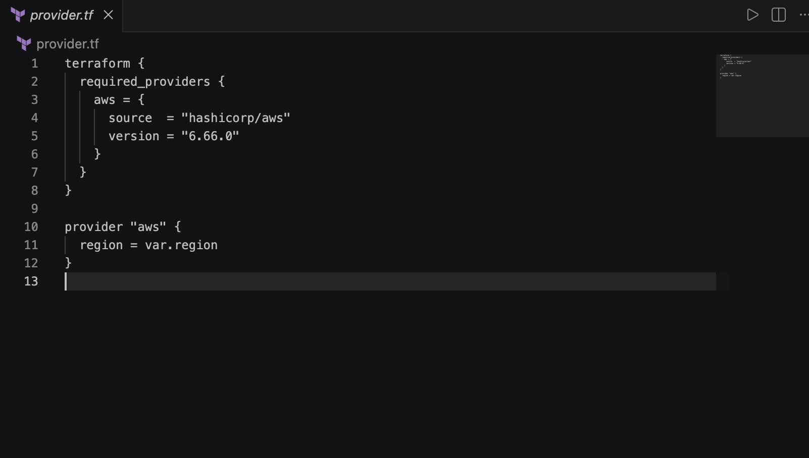

I started by configuring the AWS provider and selected `eu-west-2` as the region where I wanted my AWS infrastructure to be created. I then used `terraform init` to initialise my project and download the necessary AWS provider.

### 2. VPC Configuration

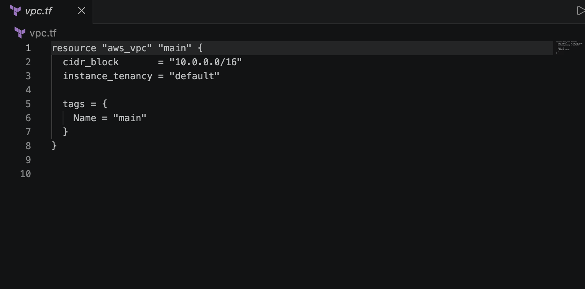

I created a VPC using Terraform resource blocks and assigned it the CIDR block `10.0.0.0/16`. This established the main network where my AWS resources would be configured.

### 3. Subnet Configuration

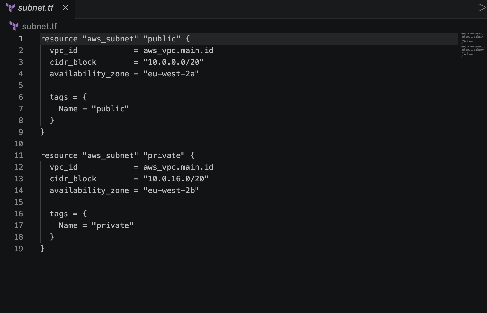

I created two subnets, one public and one private. I assigned the public subnet `10.0.0.0/20` and the private subnet `10.0.16.0/20`. I made sure that the CIDR blocks did not overlap with one another.

### 4. Internet Gateway

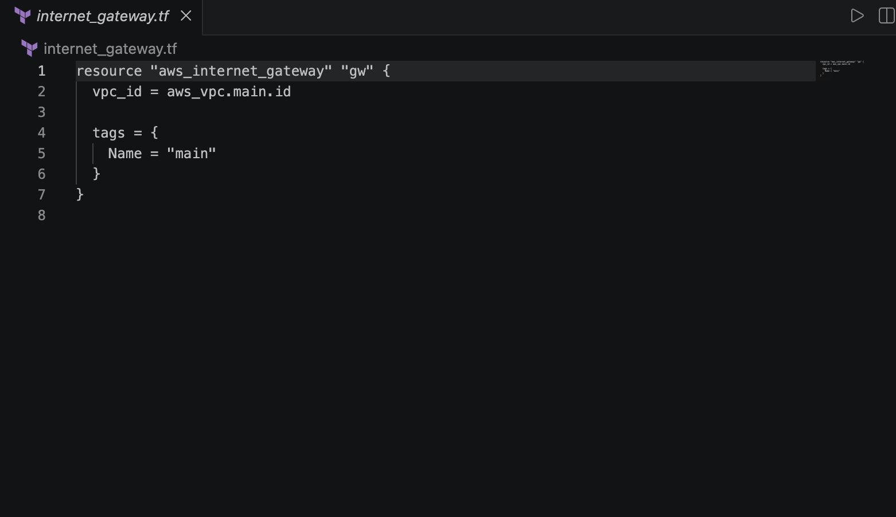

After creating the VPC, I configured an Internet Gateway and attached it to the VPC. This was important because the public subnet needed internet access through its route table.

### 5. Route Tables

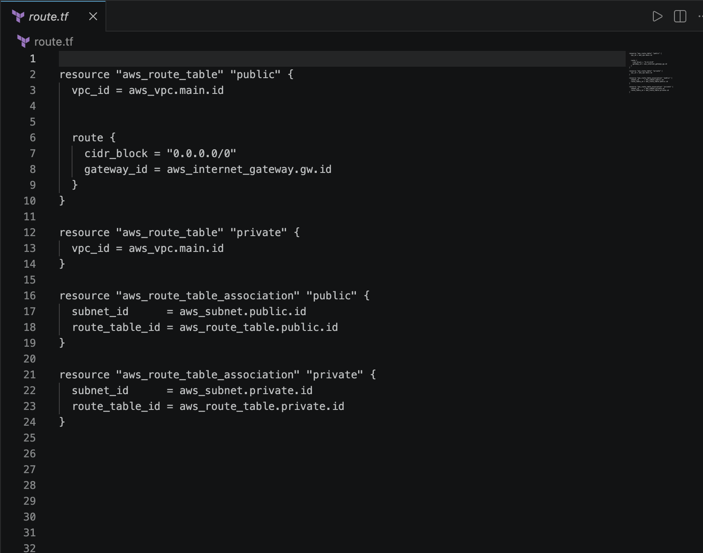

I created route tables and associated them with the relevant subnets. Furthermore, I configured the public route table to use the Internet Gateway so that my EC2 instance could establish an internet connection.

### 6. Security Group

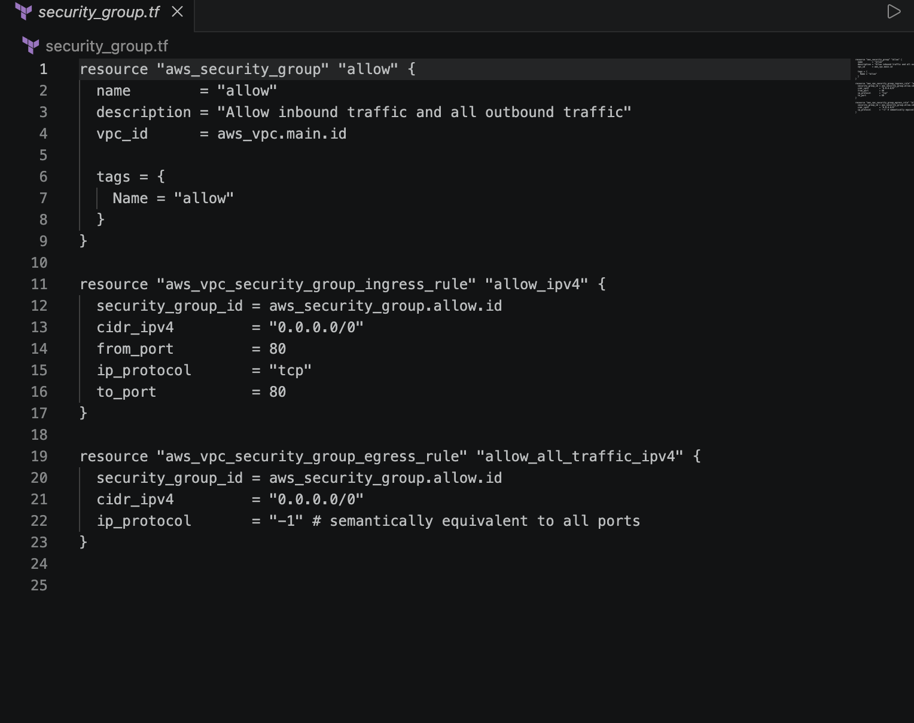

I created a security group and configured an inbound rule to allow HTTP connections using the TCP protocol on port `80`. In regards to outbound connections, I allowed traffic to all IPv4 addresses using `0.0.0.0/0`.

### 7. IAM Configuration

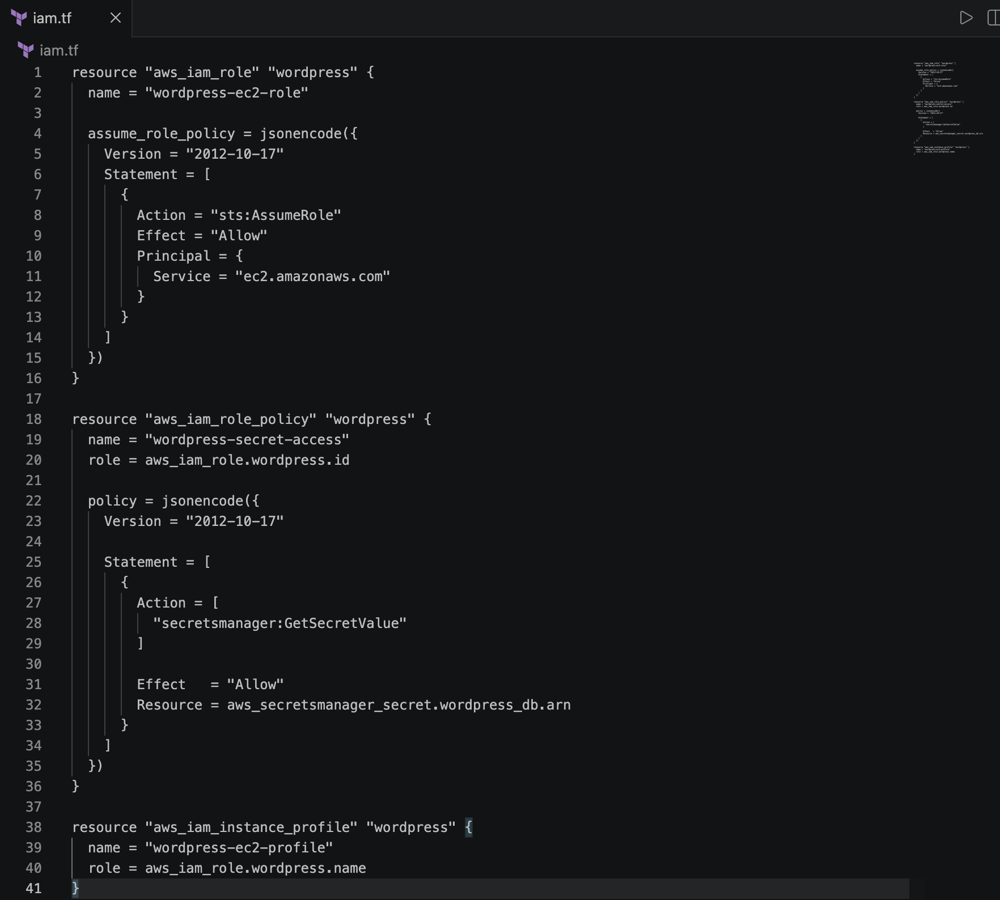

I configured an IAM role and instance profile to give my EC2 instance the necessary permissions to access AWS Secrets Manager. This allowed the instance to retrieve the database password required for the WordPress installation.

### 8. Terraform Variables

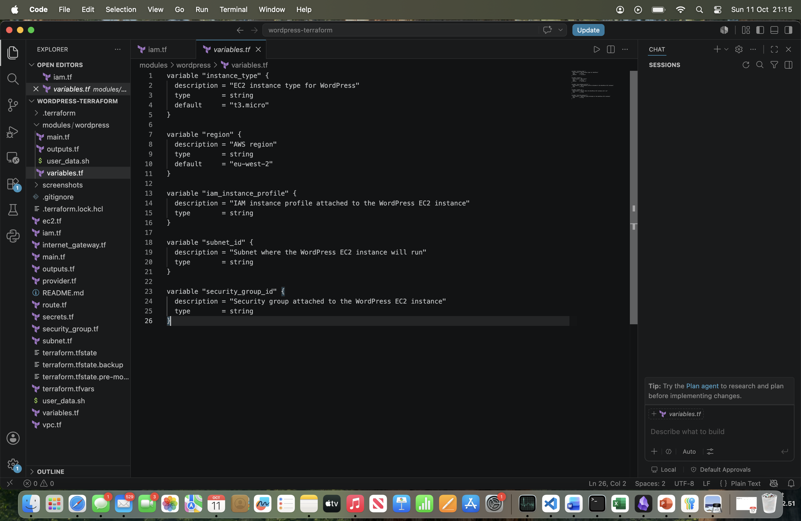

I used variables throughout my Terraform configuration to avoid repeating certain values in different resource blocks. This helped me follow the DRY principle and made the code easier to manage.

### 9. Terraform Outputs

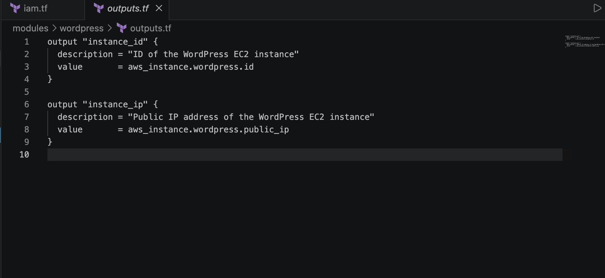

I created outputs to display the EC2 instance ID and its public IP address after deployment. This allowed me to identify my EC2 instance and access the WordPress website through the browser.

### 10. WordPress Installation Script

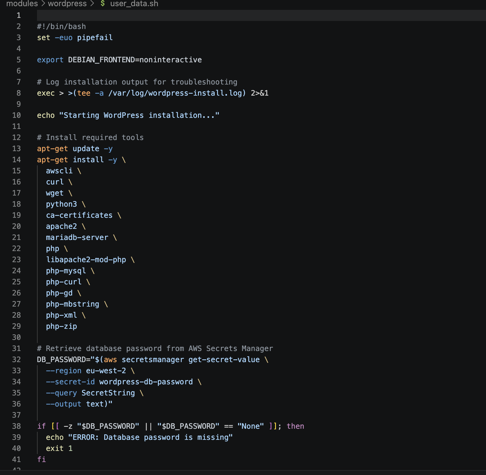

I created a Bash script called `user_data.sh` to install the necessary dependencies for WordPress. This included Apache, PHP, MariaDB and WordPress itself. The purpose of the script was to automate the installation process rather than manually installing each dependency on the EC2 instance.

### WordPress Website

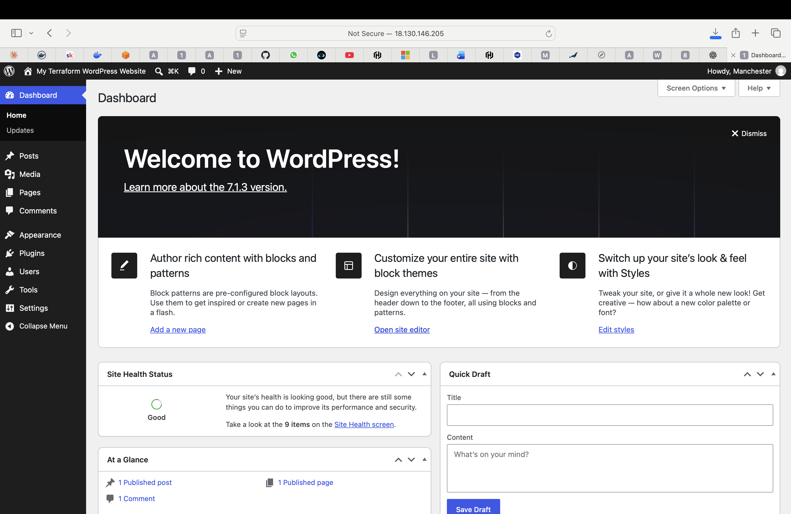

After configuring the AWS infrastructure and resolving the installation errors, I successfully accessed my WordPress website through the EC2 instance's public IP address.

---

## Terraform Commands Used

Throughout this assignment, I used `terraform init` to initialise the project, `terraform fmt` to format the code, and `terraform validate` to check for errors. I also used `terraform plan` to review any changes before running `terraform apply` to deploy the AWS resources. Furthermore, I used `terraform state list` to check which resources Terraform was managing. When creating my WordPress module, I used a `moved` block, and the final plan showed `0 to add, 0 to change, 0 to destroy`.

## AWS IAM Permissions

In order to allow my local Terraform configuration to manage resources in AWS, I configured permissions for my IAM user, `terraform-test`, through the AWS Console. I added `AmazonEC2FullAccess`, `SecretsManagerReadWrite` and a custom policy called `TerraformWordPressIAMPolicy`. Initially, the deployment failed because the `iam:CreateRole` permission was missing. After updating the permissions, I was able to continue. I also configured the EC2 role with `wordpress-secret-access` and added `AmazonSSMManagedInstanceCore` to allow access through AWS Systems Manager Session Manager.

## Errors Encountered and Troubleshooting

Although the EC2 instance was successfully created, I initially struggled to get WordPress running. The first issue involved database password validation in my Bash script. After correcting this and replacing the instance, the website still wasn't loading. I used AWS Session Manager to investigate the cloud-init logs and discovered an empty line before `#!/bin/bash`, which prevented the installation script from running. After removing the empty line and running the script again, WordPress installed successfully, and I was able to access both the website and WordPress administration dashboard.

